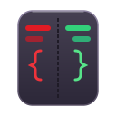
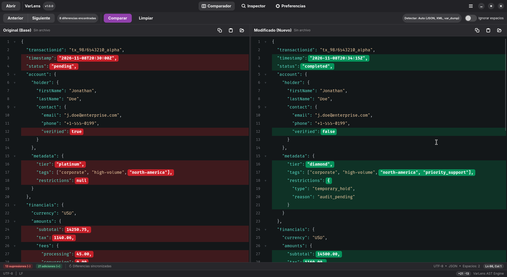
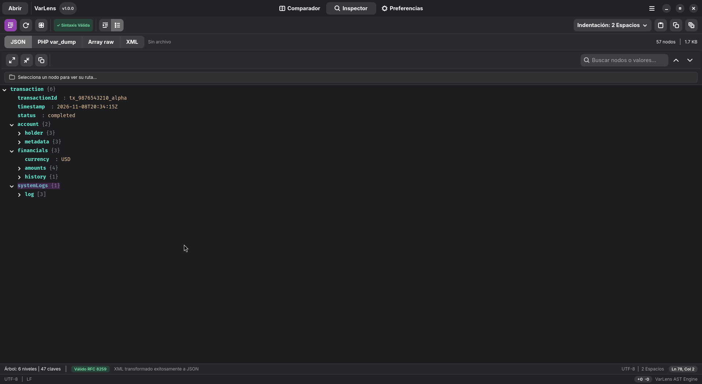
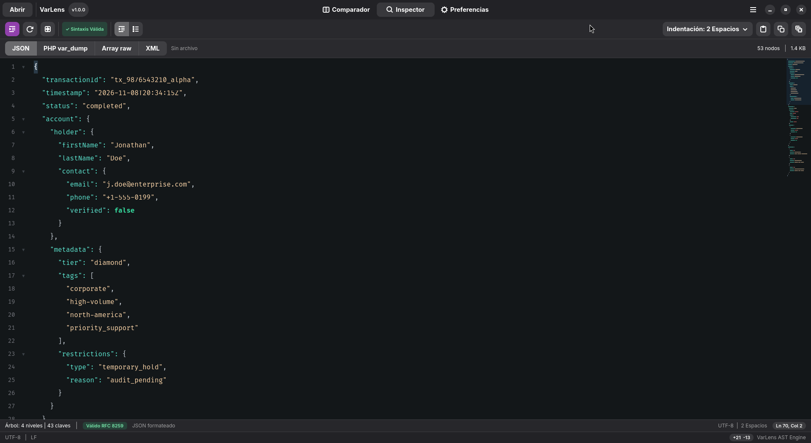
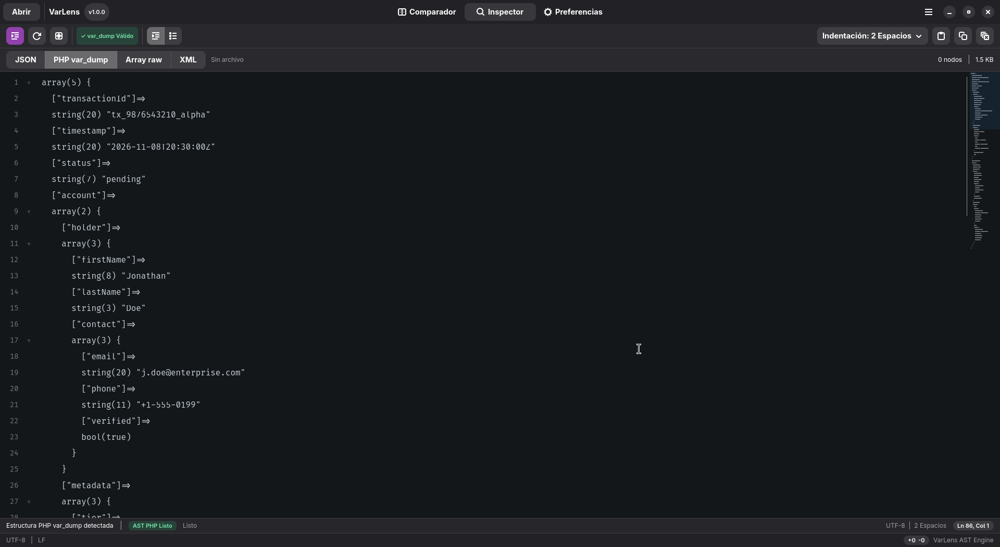
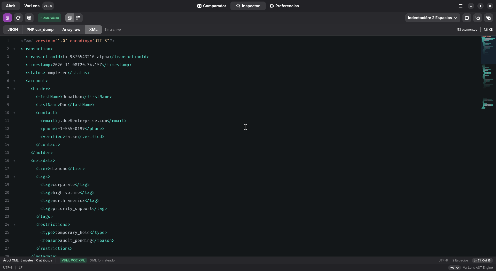

<div align="center">



# VarLens

### The modern, blazing-fast native Linux developer lens for inspecting, visualizing, converting, and diffing structured data.

<a href="https://flathub.org/apps/io.github.PinedaMB.VarLens">
  
</a>

<br/><br/>

[](https://flathub.org/apps/io.github.PinedaMB.VarLens)
[](https://github.com/PinedaMB/VarLens/releases)
[](https://www.rust-lang.org)
[](https://gtk.org)
[](https://gnome.pages.gitlab.gnome.org/libadwaita)
[](https://github.com/PinedaMB/VarLens/releases)
[](LICENSE)
[](https://buymeacoffee.com/rainbowfacp)

</div>

---

## 🌟 Why VarLens?

Modern backend and full-stack developers constantly deal with diverse structured formats: API JSON responses, legacy XML payloads, PHP debugging dumps (`var_dump()`, `print_r()`, `var_export()`), and complex file differences. 

Web-based formatters compromise sensitive credentials and struggle with multi-megabyte payloads. Heavy IDEs are slow to open. 

**VarLens** is engineered specifically for Linux developers as a **zero-compromise, native desktop application**. Built with **Rust**, **GTK4**, and **Libadwaita**, it launches instantly, operates completely offline, runs heavy operations asynchronously, and adheres to GNOME's modern design standards.

---

## 📸 Screenshots

<div align="center">

### Side-by-Side Visual Diff Comparator


<br/><br/>

| Interactive Tree Explorer | JSON Inspector &amp; Live AST Metrics |
| :---: | :---: |
|  |  |

| PHP `var_dump()` &amp; `print_r()` Parser | XML Inspector &amp; W3C Validation |
| :---: | :---: |
|  |  |

</div>

---

## ✨ Features at a Glance

### 🔍 Interactive JSON & XML Inspector
- **Dual View Modes:** Seamlessly toggle between an editable source view with custom code folding (`GtkSourceView 5`) and an **Interactive Tree Explorer**.
- **Semantic Type Badges in Tree View:** Styled visual pills for objects (`{}` with key count), arrays (`[]` with item count), strings (`STR`), links (`URL`), numbers (`NUM`), booleans (`BOOL`), and `NULL`.
- **Collapsible Hierarchies & Gutter Folding:** Deep node unfolding in Tree View and non-destructive block folding in the code editor with active-line bold numbers and folded-block highlight bars.
- **Interactive Code Minimap (`GtkSourceMap`):** Smooth 1:1 slider dragging and click-to-jump navigation across large payloads.
- **Live Code & Tree Search:** Instant search inside the code editor (`Ctrl+F`) with match highlighting, plus case-insensitive key/value search in the Tree View with match navigation (`1/N`) and auto-expansion.
- **Instant Path & Value Copying:** Click any node in the Tree View to copy its programmatic access path (e.g., `data.users[0]["api.key"]`) **or** copy its raw value / formatted sub-JSON directly to your clipboard.
- **Recursive Key Sorting (`A→Z`):** Sort all JSON object keys alphabetically at every nesting level (`Ctrl+Shift+S`).
- **XML to JSON Conversion:** Convert XML payloads (including `@attributes`, `#text`, and `CDATA` blocks) into structured JSON for inspection in the Interactive Tree Explorer.
- **RFC 8259 & W3C Validation:** Live AST syntax validation badges, key counts, tree depth, and payload metrics.
- **Flexible Formatting:** Format with 2 spaces, 4 spaces, or tabs, or compact into a single line (Minify).

### 🐘 First-Class PHP `var_dump()`, `print_r()` & `var_export()` Parser
- **Formal PEG Grammar:** Powered by a robust `pest` PEG parser that faithfully deserializes PHP dump outputs into valid JSON.
- **Handles PHP Complexity:** Supports typed primitives (`bool`, `int`, `float`, `string(N)`), references (`&`), visibility modifiers (`public`, `protected`, `private`), sequential arrays, associative arrays, objects, and nested recursion flags (`*RECURSION*`).
- **Raw Array & `var_export()` Support:** Dedicated auto-detection and parsing for PHP `print_r()` (`Array (...)`, `stdClass Object`), traditional `var_export()` (`array('k' => 'v')`, `ClassName::__set_state(...)`), and short array syntax (`['k' => 'v']`).
- **One-Click Conversion:** Transform raw PHP dumps into formatted JSON (`Ctrl+Shift+J`) or explore them directly in the Interactive Tree View.

### ⚖️ Side-by-Side Visual Diff Comparator
- **Synchronized Dual View:** Coordinated vertical scrolling and synchronized cursor tracking between base and modified editors with distinct red/green panel header accents.
- **Granular Change Detection:** Visualizes line additions (green) and deletions (red) with **3.5px vertical gutter stripes** and **inline word/character-level highlight spans**.
- **Live Similarity Metric:** Real-time similarity percentage badge (`% similarity`) alongside addition/deletion counters.
- **Diff Workflow Power Tools:**
  - **Swap Panels (`↔`):** Swap Original (Left) and Modified (Right) contents in a single click.
  - **Normalize Before Diff:** Auto-format and canonicalize both panels (JSON, XML, or PHP dumps) before comparing.
  - **Export Unified Diff (`.patch`):** Copy standard Unified Diff patch output directly to your clipboard.
- **Myers & Patience Algorithms:** Toggle between the standard Myers algorithm and the **Patience algorithm** in Preferences for clean, semantic structural diffs.
- **Whitespace Agnostic:** Ignore whitespace differences with a single switch.
- **Diff Chunk Navigation:** Jump quickly between changes with `Ctrl+[` and `Ctrl+]`.

### 🎨 Desktop UX, Themes & Internationalization
- **Instant Light / Dark Theme Toggle:** Switch between custom `varlens-dark` and `varlens-light` themes directly from the HeaderBar with full synchronization across Libadwaita, GtkSourceView, and the Tree Explorer.
- **One-Click Demo Loader:** Load rich, realistic sample payloads tailored to the active tool (`Diff`, `JSON`, `XML`, `var_dump`, or `print_r`).
- **Drag & Drop + File Save:** Drag files directly into the window to inspect or compare, and save formatted outputs to disk (`Ctrl+S`).
- **True Non-Blocking Concurrency:** Payloads exceeding threshold limits are automatically offloaded to background worker threads (`std::thread`), keeping the UI fluid at 60 FPS.
- **Native Internationalization (i18n):** Real-time **English** and **Spanish** interface switching in Preferences without application restarts.

---

## ⌨️ Keyboard Shortcuts

| Shortcut | Action | Scope |
| :--- | :--- | :--- |
| <kbd>Ctrl</kbd> + <kbd>O</kbd> | Open File | Global |
| <kbd>Ctrl</kbd> + <kbd>S</kbd> | Save Formatted Output to File | Global |
| <kbd>Ctrl</kbd> + <kbd>F</kbd> | Focus Live Code Search | Inspector |
| <kbd>Ctrl</kbd> + <kbd>Shift</kbd> + <kbd>F</kbd> | Format / Prettify Content | Inspector |
| <kbd>Ctrl</kbd> + <kbd>Shift</kbd> + <kbd>M</kbd> | Minify Content | Inspector |
| <kbd>Ctrl</kbd> + <kbd>Shift</kbd> + <kbd>S</kbd> | Sort JSON Keys Alphabetically (`A→Z`) | Inspector |
| <kbd>Ctrl</kbd> + <kbd>Shift</kbd> + <kbd>J</kbd> | Convert `var_dump` / `print_r` / XML to JSON | Inspector |
| <kbd>Ctrl</kbd> + <kbd>Enter</kbd> | Recalculate Differences | Diff Viewer |
| <kbd>Ctrl</kbd> + <kbd>[</kbd> | Jump to Previous Difference | Diff Viewer |
| <kbd>Ctrl</kbd> + <kbd>]</kbd> | Jump to Next Difference | Diff Viewer |
| <kbd>Ctrl</kbd> + <kbd>Shift</kbd> + <kbd>C</kbd> / <kbd>D</kbd> | Clear All Diff Inputs | Diff Viewer |
| <kbd>F1</kbd> / <kbd>Ctrl</kbd> + <kbd>?</kbd> | View Shortcuts Dialog | Global |

---

## 🛠️ Tech Stack

- **Core Language:** [Rust 2021 Edition](https://www.rust-lang.org/)
- **UI Toolkit:** [GTK 4.12+](https://gtk.org/) via [`gtk4-rs`](https://gtk-rs.org/)
- **Human Interface Guidelines:** [Libadwaita 1.5+](https://gnome.pages.gitlab.gnome.org/libadwaita/)
- **Source Editor:** [GtkSourceView 5](https://gitlab.gnome.org/GNOME/gtksourceview) with custom light and dark color schemes
- **Diff Engine:** [`similar`](https://crates.io/crates/similar) with Myers & Patience algorithms and inline span computation
- **Parser Engine:** [`pest`](https://pest.rs/) PEG grammar parser + [`roxmltree`](https://crates.io/crates/roxmltree)
- **Serialization:** [`serde_json`](https://crates.io/crates/serde_json) with key order preservation (`preserve_order`)

---

## 📥 Installation

### Flathub (Recommended)

VarLens is available on [Flathub](https://flathub.org/apps/io.github.PinedaMB.VarLens) for all major Linux distributions:

<a href="https://flathub.org/apps/io.github.PinedaMB.VarLens">
  
</a>

```bash
# Install from Flathub
flatpak install flathub io.github.PinedaMB.VarLens

# Run VarLens
flatpak run io.github.PinedaMB.VarLens
```

---

## 🚀 Building & Running from Source

### Prerequisites

Ensure you have Rust and the required GTK4 / Libadwaita development libraries installed:

#### Fedora / RHEL
```bash
sudo dnf install -y rust cargo gtk4-devel libadwaita-devel gtksourceview5-devel
```

#### Ubuntu / Debian / Zorin OS (24.04+)
```bash
sudo apt install -y cargo rustc pkg-config libgtk-4-dev libadwaita-1-dev libgtksourceview-5-dev
```

#### Arch Linux
```bash
sudo pacman -S rust gtk4 libadwaita gtksourceview5
```

### Build & Run

```bash
# Clone the repository
git clone https://github.com/PinedaMB/VarLens.git
cd VarLens

# Run unit test suite
cargo test

# Build and execute in development mode
cargo run

# Build an optimized production release binary
cargo build --release
```

The optimized release executable will be available at `./target/release/varlens`.

---

## 📦 Desktop Integration

To install VarLens locally for your user account:

```bash
# Copy binary
install -Dm755 target/release/varlens ~/.local/bin/varlens

# Install application icon
install -Dm644 data/icons/hicolor/scalable/apps/io.github.PinedaMB.VarLens.svg \
  ~/.local/share/icons/hicolor/scalable/apps/io.github.PinedaMB.VarLens.svg

# Install desktop entry and AppStream metadata
install -Dm644 data/io.github.PinedaMB.VarLens.desktop ~/.local/share/applications/io.github.PinedaMB.VarLens.desktop
install -Dm644 data/io.github.PinedaMB.VarLens.metainfo.xml ~/.local/share/metainfo/io.github.PinedaMB.VarLens.metainfo.xml

# Refresh icon cache and desktop database
gtk4-update-icon-cache -f -t ~/.local/share/icons/hicolor
update-desktop-database ~/.local/share/applications
```

### Windows Portable

Download `VarLens-windows-x86_64.zip` from [Releases](https://github.com/PinedaMB/VarLens/releases), extract the ZIP archive, and run `varlens.exe`. No installation or runtime dependencies required.

---

## 🗺️ Roadmap

Planned upcoming features—including **PHP `serialize()` support**, **inline smart decoding (escaped JSON, JWT, Base64)**, **live JSONPath/XPath querying**, **semantic Tree Diff**, **type/struct code generation**, and **CLI/stdin pipe support**—are documented in detail in **[ROADMAP.md](ROADMAP.md)**.

---

## 🤝 Contributing

Contributions, bug reports, and suggestions are welcome!
Feel free to open an issue or submit a pull request on [GitHub](https://github.com/PinedaMB/VarLens).

---

## 💖 Support the Project

VarLens is 100% free and open-source software built with dedication. If VarLens saves you time, simplifies your debugging, or enhances your daily development workflow, consider supporting its ongoing maintenance and new features:

<p align="left">
  <a href="https://buymeacoffee.com/rainbowfacp">
    
  </a>
</p>

- **[Buy Me a Coffee](https://buymeacoffee.com/rainbowfacp)** — Buy a coffee to support development.
- **Star the Repository** — A star on [GitHub](https://github.com/PinedaMB/VarLens) helps other Linux developers discover VarLens!

---

## 📄 License

VarLens is distributed under the open-source **[MIT License](LICENSE)**.
