# 🗺️ VarLens — Development Roadmap & New Features

This document defines the phased technical plan to evolve **VarLens** into a complete suite for inspecting, transforming, and comparing data structures on the Linux desktop (**Rust + GTK4 + Libadwaita + GtkSourceView 5**).

---

## Proposed High-Level Architecture

```mermaid
flowchart LR
    subgraph Input["1. Ingestion & Formats"]
        CLI["CLI Args & stdin Pipe"]
        Clip["Clipboard Watcher"]
        Parsers["Parsers: JSON / XML / PHP var_dump, print_r, var_export, serialize() / YAML / TOML / CSV"]
    end

    subgraph Core["2. Core Engine (src/core/)"]
        AST["Unified Model (serde_json::Value / XmlNode)"]
        Decode["Smart Decoder (Escaped JSON, JWT, Base64)"]
        Query["Query Engine (JSONPath / JMESPath / XPath)"]
        Diff["Diff Engine (Text + Semantic Tree Diff + Hunk Merge)"]
        Codegen["Type Generator (Rust, TS, PHP DTO, Go, JSON Schema)"]
    end

    subgraph UI["3. Native Interface (src/ui/)"]
        Editor["GtkSourceView 5 + Gutter Folding + Minimap Marks"]
        Tree["Interactive Tree with Inline Decoding"]
        History["Persistent History & Sessions"]
    end

    Input --> Core --> UI
```

---

## Phase 1: New Formats & Smart Decoding (Short Term)

### 1.1 PHP `serialize()` & PHP Sessions Support
Many production systems store serialized PHP payloads in Redis, Memcached, or database columns (`a:2:{s:4:"name";s:4:"John";i:0;b:1;}`).
- **Module**: `src/core/php_serialize.rs` (or an extension under `src/core/vardump/`).
- **Technical Scope**:
  - Support primitive types (`N;`, `b:0;`, `i:42;`, `d:3.14;`, `s:len:"...";`), arrays (`a:len:{...}`), objects (`O:len:"ClassName":len:{...}`), and `Serializable` objects (`C:...`).
  - Strip visibility prefixes from private/protected properties (`\0ClassName\0prop` and `\0*\0prop`).
  - Auto-detection when input starts with `a:`, `O:`, `s:`, `i:`, `b:` matching the `serialize()` pattern.
- **Tests**: Unit tests with nested structures, multibyte UTF-8 characters (exact byte length counting in `s:len`), and private properties.

### 1.2 Smart Inline Node Decoder (Smart Unescape / JWT / Base64)
In APIs and logs it is common to find escaped JSON strings inside another JSON string (`"payload": "{\"id\":123}"`), JWT tokens (`eyJ...`), or Base64 blocks.
- **Module**: `src/core/decoder.rs` and integration in `src/ui/json_tree.rs`.
- **Technical Scope**:
  - **Heuristic detection on `STR` nodes**:
    - **Escaped JSON**: If the string starts with `{` or `[` and parses as valid JSON.
    - **JWT**: If it matches `header.payload.signature` in Base64URL and the first two segments decode to valid JSON.
    - **Base64**: If length is a multiple of 4, uses a valid alphabet, and decodes to readable UTF-8 or JSON.
  - **Tree UI (`JsonTreeView`)**:
    - Show specific badges (`JSON-STR`, `JWT`, `B64`) next to the node.
    - Toolbar button to **"Expand / Decode node inline"**, inserting the decoded subtree as children of the current node.

### 1.3 Bidirectional Support for YAML, TOML, and CSV
- **Modules**: `src/core/yaml.rs`, `src/core/toml_fmt.rs`, `src/core/csv_fmt.rs`.
- **Suggested Dependencies**: `serde_yaml` (or `serde_yml`), `toml`, `csv`.
- **Technical Scope**:
  - Direct conversion to/from `serde_json::Value` to reuse the **Interactive Tree** without duplicating UI components.
  - Syntax highlighting in `GtkSourceView` (`yaml`, `toml`, `csv`).

---

## Phase 2: Querying, Filtering & Code Generation (Medium Term)

### 2.1 Interactive Query Console (JSONPath / JMESPath & XPath)
- **Module**: `src/core/query.rs`.
- **Suggested Dependencies**: `serde_json_path` (RFC 9535) or `jmespath`, plus a lightweight XPath evaluator over the XML tree.
- **Technical Scope**:
  - Add a collapsible query bar in the Inspector (`$.store.book[?(@.price < 10)].title`).
  - Live evaluation (with a 150 ms *debounce*) showing the resulting subset in both the code editor and the Interactive Tree.
  - Matching node count indicator and basic key autocompletion for the current level.

### 2.2 Type & Struct Generator (Codegen)
Infer the schema of the current payload (JSON, XML, or converted `var_dump`) and generate ready-to-copy code.
- **Module**: `src/core/codegen.rs`.
- **Output Formats**:
  - **Rust**: `struct` with `#[derive(Debug, Clone, Serialize, Deserialize)]` and `#[serde(rename = "...")]` where applicable.
  - **TypeScript**: `interface` / `type` with optional field (`?`) detection across heterogeneous arrays of objects.
  - **PHP 8.2+**: `readonly class` DTO with strict types and PHPDoc.
  - **Go**: `struct` with `` `json:"..."` `` tags.
  - **JSON Schema**: Automatically inferred Draft 2020-12 schema.
- **UI**: Modal dialog (`AdwDialog` / `AdwWindow`) with language selector, `GtkSourceView` preview, and quick-copy button.

---

## Phase 3: Diff Engine Evolution (Diff Viewer)

### 3.1 Semantic / Structural Diff (Tree Diff)
Compare two data structures by meaning rather than line-by-line text.
- **Module**: `src/core/tree_diff.rs` and view in `src/ui/json_tree.rs`.
- **Technical Scope**:
  - Recursively compare two `serde_json::Value` trees ignoring formatting, whitespace, and object key order.
  - Classify each path (`$.path.to.node`) as:
    - 🟢 **Added**: New key or index in the right panel.
    - 🔴 **Removed**: Key or index missing from the left panel.
    - 🟡 **Modified**: Shows the exact inline change (`"30"` → `"60"`).
  - Quick filter to show **only changed nodes** in the tree.

### 3.2 Partial Block Merging (Merge Hunks `→` / `←`)
- **Module**: `src/ui/diff_editor.rs` and `src/ui/window/diff.rs`.
- **Technical Scope**:
  - Per-hunk actions to copy a specific block from **Original → Modified** or **Modified → Original** without affecting the rest of the document.
  - Support `Ctrl+Z` (Undo in the target `sourceview5::Buffer`) after applying a hunk.

### 3.3 Visual Diff Marks on Minimap & Scrollbar
- **Module**: `src/ui/diff_editor.rs`.
- **Technical Scope**:
  - Draw horizontal red (deletions) and green (additions) markers proportional to file position along the side edge of the diff editors to locate changes in files with thousands of lines.

---

## Phase 4: Productivity & Linux Desktop Workflow

### 4.1 Full CLI & Pipe (`stdin`) Support
Allow using **VarLens** directly from the terminal or developer scripts:
- **Module**: `src/main.rs` and `src/ui/window/mod.rs`.
- **Use Cases**:
  - `varlens payload.json`: Opens directly into the matching mode (JSON, XML, or `var_dump`) with the file loaded.
  - `varlens original.json new.json`: Opens directly into the **Comparator (Diff)** view and runs the comparison between both files.
  - `php artisan tinker ... | varlens` or `curl -s https://api.example.com/data | varlens`: Reads from `stdin` when not an interactive TTY and loads it automatically into the Inspector.

### 4.2 Persistent Session & Tab History
- **Module**: `src/core/history.rs`.
- **Technical Scope**:
  - Store locally in `glib::user_data_dir().join("varlens")` the last N inspected sessions/payloads (with timestamp, size, format type, and preview).
  - Optionally restore the last session on app startup.
  - **Recent History** popover/panel in `AdwHeaderBar`.

### 4.3 Optional Clipboard Watcher
- **Module**: `src/ui/window/mod.rs` (`gdk::Clipboard::connect_changed`).
- **Technical Scope**:
  - Optional toggle in preferences or top bar (*"Auto-inspect clipboard"*).
  - When active and the user copies text matching valid JSON, XML, or `var_dump()`/`print_r()` output, VarLens loads and formats it automatically (showing a subtle `AdwToast` notification with an undo option).

---

## Suggested Prioritization Summary

| Priority | Feature | Complexity | UX Impact |
| :---: | :--- | :---: | :---: |
| **P1** | PHP `serialize()` support | Medium | High (Key PHP differentiator) |
| **P1** | Inline Tree Decoder (escaped JSON, JWT, Base64) | Low–Medium | Very High |
| **P1** | CLI support (`varlens file1 file2` & `stdin` pipe) | Low | High |
| **P2** | Live JSONPath / XPath query console | Medium | Very High |
| **P2** | Semantic Tree Diff + Merge Hunks | Medium–High | High |
| **P3** | Type Generator (Rust, TypeScript, PHP DTO, Go) | Medium | Medium–High |
| **P3** | YAML / TOML / CSV support | Low | Medium |
| **P4** | Persistent History + Clipboard Watcher | Medium | Medium |
