# 🗺️ VarLens — Roadmap de Desarrollo y Nuevas Funcionalidades

Este documento define el plan técnico por fases para evolucionar **VarLens** hacia una suite completa de inspección, transformación y comparación de estructuras de datos para escritorio Linux (**Rust + GTK4 + Libadwaita + GtkSourceView 5**).

---

## Arquitectura General Propuesta

```mermaid
flowchart LR
    subgraph Entrada["1. Ingesta y Formatos"]
        CLI["CLI Args & stdin Pipe"]
        Clip["Clipboard Watcher"]
        Parsers["Parsers: JSON / XML / PHP var_dump, print_r, var_export, serialize() / YAML / TOML / CSV"]
    end

    subgraph Core["2. Motor Core (src/core/)"]
        AST["Modelo Unificado (serde_json::Value / XmlNode)"]
        Decode["Smart Decoder (JSON Escapado, JWT, Base64)"]
        Query["Motor de Consultas (JSONPath / JMESPath / XPath)"]
        Diff["Diff Engine (Texto + Tree Diff Semántico + Hunk Merge)"]
        Codegen["Generador de Tipos (Rust, TS, PHP DTO, Go, JSON Schema)"]
    end

    subgraph UI["3. Interfaz Nativa (src/ui/)"]
        Editor["GtkSourceView 5 + Gutter Folding + Minimap Marks"]
        Tree["Árbol Interactivo con Decodificación Inline"]
        History["Historial Persistente y Sesiones"]
    end

    Entrada --> Core --> UI
```

---

## Fase 1: Nuevos Formatos y Decodificación Inteligente (Corto Plazo)

### 1.1 Soporte para `serialize()` de PHP y Sesiones PHP
Muchos sistemas en producción almacenan payloads de PHP serializados en Redis, Memcached o columnas de base de datos (`a:2:{s:4:"name";s:4:"John";i:0;b:1;}`).
- **Módulo**: `src/core/php_serialize.rs` (o extensión en `src/core/vardump/`).
- **Alcance técnico**:
  - Soportar tipos primitivos (`N;`, `b:0;`, `i:42;`, `d:3.14;`, `s:len:"...";`), arreglos (`a:len:{...}`), objetos (`O:len:"ClassName":len:{...}`) y objetos con `Serializable` (`C:...`).
  - Limpiar prefijos de visibilidad de propiedades privadas/protegidas (`\0ClassName\0prop` y `\0*\0prop`).
  - Detección automática en `detect_and_switch_tool` cuando la entrada comience con `a:`, `O:`, `s:`, `i:`, `b:` seguido del patrón de `serialize()`.
- **Pruebas**: Tests unitarios con estructuras anidadas, caracteres multibyte UTF-8 (conteo de bytes exacto en `s:len`) y propiedades privadas.

### 1.2 Decodificador Inteligente de Nodos Inline (Smart Unescape / JWT / Base64)
En APIs y logs es común encontrar cadenas JSON escapadas dentro de otra cadena JSON (`"payload": "{\"id\":123}"`), tokens JWT (`eyJ...`) o bloques en Base64.
- **Módulo**: `src/core/decoder.rs` e integración en `src/ui/json_tree.rs`.
- **Alcance técnico**:
  - **Detección heurística en nodos `STR`**:
    - **JSON Escapado**: Si el string empieza por `{` o `[` y es un JSON válido al parsearse.
    - **JWT**: Si cumple el formato `header.payload.signature` en Base64URL y los dos primeros segmentos decodifican a JSON válido.
    - **Base64**: Si tiene longitud múltiplo de 4, alfabeto válido y decodifica a UTF-8 legible o JSON.
  - **Interfaz en el Árbol (`JsonTreeView`)**:
    - Mostrar badges específicos (`JSON-STR`, `JWT`, `B64`) junto al nodo.
    - Botón en la barra del árbol para **"Expandir / Decodificar nodo inline"**, insertando el sub-árbol decodificado como hijos del nodo actual.

### 1.3 Soporte Bidireccional para YAML, TOML y CSV
- **Módulos**: `src/core/yaml.rs`, `src/core/toml_fmt.rs`, `src/core/csv_fmt.rs`.
- **Dependencias sugeridas**: `serde_yaml` (o `serde_yml`), `toml`, `csv`.
- **Alcance técnico**:
  - Conversión directa hacia/desde `serde_json::Value` para reutilizar el **Árbol Interactivo** sin duplicar componentes UI.
  - Resaltado de sintaxis en `GtkSourceView` (`yaml`, `toml`, `csv`).

---

## Fase 2: Consultas, Filtrado y Generación de Código (Mediano Plazo)

### 2.1 Consola Interactiva de Consultas (JSONPath / JMESPath y XPath)
- **Módulo**: `src/core/query.rs`.
- **Dependencias sugeridas**: `serde_json_path` (RFC 9535) o `jmespath`, y evaluador XPath ligero sobre el árbol XML.
- **Alcance técnico**:
  - Añadir una barra de consulta colapsable en el Inspector (`$.store.book[?(@.price < 10)].title`).
  - Evaluación en vivo (con *debounce* de 150 ms) mostrando el subconjunto resultante tanto en el editor de código como en el Árbol Interactivo.
  - Indicador del número de nodos coincidentes y autocompletado básico de claves del nivel actual.

### 2.2 Generador de Tipos y Structs (Codegen)
Inferir el esquema del payload actual (JSON, XML o `var_dump` convertido) y generar código listo para copiar al portapapeles.
- **Módulo**: `src/core/codegen.rs`.
- **Formatos de salida**:
  - **Rust**: `struct` con `#[derive(Debug, Clone, Serialize, Deserialize)]` y `#[serde(rename = "...")]` cuando aplique.
  - **TypeScript**: `interface` / `type` con detección de campos opcionales (`?`) en arreglos de objetos heterogéneos.
  - **PHP 8.2+**: `readonly class` DTO con tipos estrictos y PHPDoc.
  - **Go**: `struct` con etiquetas `` `json:"..."` ``.
  - **JSON Schema**: Borrador Draft 2020-12 inferido automáticamente.
- **Interfaz**: Diálogo modal (`AdwDialog` / `AdwWindow`) con selector de lenguaje, vista previa en `GtkSourceView` y botón de copia rápida.

---

## Fase 3: Evolución del Motor de Diferencias (Diff Viewer)

### 3.1 Diff Semántico / Estructural (Tree Diff)
Comparar dos estructuras de datos por significado en lugar de línea por línea de texto.
- **Módulo**: `src/core/tree_diff.rs` y vista en `src/ui/json_tree.rs`.
- **Alcance técnico**:
  - Comparar recursivamente dos `serde_json::Value` ignorando formato, espacios y orden de claves en objetos.
  - Clasificar cada ruta (`$.ruta.al.nodo`) como:
    - 🟢 **Añadido** (`Added`): Clave o índice nuevo en el panel derecho.
    - 🔴 **Eliminado** (`Removed`): Clave o índice que desapareció del panel izquierdo.
    - 🟡 **Modificado** (`Modified`): Muestra el cambio exacto en línea (`"30"` → `"60"`).
  - Filtro rápido para mostrar **solo nodos con cambios** en el árbol.

### 3.2 Fusión Parcial de Bloques (Merge Hunks `→` / `←`)
- **Módulo**: `src/ui/diff_editor.rs` y `src/ui/window.rs`.
- **Alcance técnico**:
  - Añadir acciones por bloque (`hunk`) para copiar un bloque específico desde el panel **Original → Modificado** o **Modificado → Original** sin afectar el resto del documento.
  - Soportar `Ctrl+Z` (Undo en el `sourceview5::Buffer` destino) tras aplicar un bloque.

### 3.3 Marcas Visuales de Diferencias en el Minimapa y Scrollbar
- **Módulo**: `src/ui/diff_editor.rs`.
- **Alcance técnico**:
  - Dibujar marcadores horizontales rojos (supresiones) y verdes (adiciones) proporcionales a la posición del archivo sobre el borde lateral de los editores de Diff para ubicar cambios en archivos de miles de líneas.

---

## Fase 4: Productividad y Flujo de Escritorio Linux

### 4.1 Soporte Completo de Línea de Comandos (CLI) y Tuberías (`stdin`)
Permitir usar **VarLens** directamente desde la terminal o scripts de desarrollo:
- **Módulo**: `src/main.rs` y `src/ui/window.rs`.
- **Casos de uso**:
  - `varlens payload.json`: Abre directamente la herramienta correspondiente (JSON, XML o `var_dump`) con el archivo cargado.
  - `varlens original.json nuevo.json`: Abre directamente la vista **Comparar (Diff)** y ejecuta la comparación entre ambos archivos.
  - `php artisan tinker ... | varlens` o `curl -s https://api.ejemplo.com/data | varlens`: Lee el flujo desde `stdin` cuando no es un TTY interactivo y lo carga automáticamente en el Inspector.

### 4.2 Historial Persistente de Sesiones y Pestañas
- **Módulo**: `src/core/history.rs`.
- **Alcance técnico**:
  - Almacenar localmente en `glib::user_data_dir().join("varlens")` las últimas N sesiones/payloads inspeccionados (con fecha, tamaño, tipo de formato y vista previa).
  - Restaurar opcionalmente la última sesión al abrir la aplicación.
  - Panel o menú desplegable de **Historial Reciente** en la `AdwHeaderBar`.

### 4.3 Monitor Opcional de Portapapeles (Clipboard Watcher)
- **Módulo**: `src/ui/window.rs` (`gdk::Clipboard::connect_changed`).
- **Alcance técnico**:
  - Interruptor opcional en la barra superior o preferencias (*"Auto-inspeccionar portapapeles"*).
  - Cuando está activo y el usuario copia un bloque que coincide con un JSON válido, XML o salida de `var_dump()`/`print_r()`, VarLens lo carga y formatea automáticamente (mostrando una notificación sutil tipo `AdwToast` con opción de deshacer).

---

## Resumen de Priorización Sugerida

| Prioridad | Funcionalidad | Complejidad | Impacto en UX |
| :---: | :--- | :---: | :---: |
| **P1** | Soporte para `serialize()` de PHP | Media | Alto (Diferenciador clave en PHP) |
| **P1** | Decodificador Inline en Árbol (JSON escapado, JWT, Base64) | Baja–Media | Muy Alto |
| **P1** | Soporte CLI (`varlens file1 file2` y pipe `stdin`) | Baja | Alto |
| **P2** | Consola de consultas JSONPath / XPath en vivo | Media | Muy Alto |
| **P2** | Diff Semántico en Árbol (Tree Diff) + Merge de Hunks | Media–Alta | Alto |
| **P3** | Generador de Tipos (Rust, TypeScript, PHP DTO, Go) | Media | Medio–Alto |
| **P3** | Soporte YAML / TOML / CSV | Baja | Medio |
| **P4** | Historial Persistente + Clipboard Watcher | Media | Medio |
